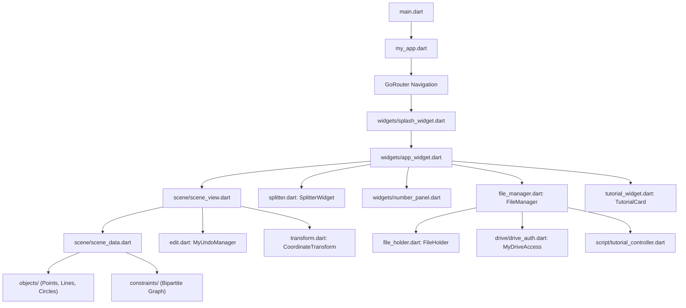

# GEMINI.md - Developer Guide for Hyperbolic Drawing Tool

Welcome! This guide is designed to help future LLM agents and human developers
get up to speed quickly on the **Hyperbolic** Flutter application.

-------------------------------------------------------------------------------

## Developer Rules & Environment Configuration

All contributors and AI agents must follow the central rules defined in
`~/source/gemini/config/rules/`:

- **Task Management (`todo.md`)**: Project tasks and issues are tracked using
  `~/bin/todo.py`. When asked about tasks or what to work on next, execute:

  ``` bash
  ~/bin/todo.py list
  ```

Before starting an item, mark it in progress (`~/bin/todo.py doing <N>`). Once
completed, mark it done (`~/bin/todo.py done <N>`). Do not archive completed
tasks until reviewed and verified.

- **Communication Style (`style.md`)**: Be blunt and direct. Avoid polite
  filler and superlatives. Keep responses concise, technical, and focused
  strictly on facts and instructions.

- **Documentation Formatting (`markdown.md`)**: Keep line lengths strictly
  under 80 characters. Always separate list items with a blank line. Always
  follow headers with a blank line. Visually align markdown table column
  borders (`|`).

- **Emacs Integration (`emacs.md`)**: When requested to send a file to Emacs,
  run `emacs-maybe-client -f <file>`.

- **Hardware & Testing (`devices.md`)**: On host `raven`, an Android device may
  be connected via `adb` for Android testing.

-------------------------------------------------------------------------------

## 1. Project Purpose & Features

The Hyperbolic Drawing Tool is an interactive, cross-platform (Web and Android)
application used to construct, visualize, and explore hyperbolic geometry
diagrams within the PoincaréDisk model:

$$\mathbb{D} = \{z \in \mathbb{C} : |z| < 1\}$$

In the Poincarédisk, points are points within the open unit disk, and
hyperbolic lines (geodesics) are circular arcs orthogonal to the boundary
circle (plus disk diameters). All of neutral geometry (Euclid’s postulates
without the parallel postulate) holds in this space. This tool lets users
perform classical straightedge-and-compass constructions adapted to hyperbolic
geometry.

### Key Features

- **PoincaréDisk Canvas**: Interactive rendering of the unit disk, points,
  geodesic lines, rays, segments, and hyperbolic circles.

- **Dual Viewport Navigation**:

  - **Euclidean Zoom & Pan**: Magnify fine details near the boundary circle
    where hyperbolic distance expands exponentially.

  - **Hyperbolic Translation (Möbius Isometry Mode)**: Apply disk automorphisms
    to smoothly translate any hyperbolic point to the center of the disk while
    preserving all hyperbolic lengths, circles, and angles.

- **Bipartite Constraint Graph & Inverse Solver**:

  - Alternating graph of geometric objects / numbers and constraint nodes.

  - Topological forward evaluation for ancestor parameter changes.

  - Damped numerical inverse solver (using the Jacobian) allowing direct
    dragging of derived objects while respecting locked states.

- **Number Objects & Interactive Sliders**:

  - Responsive split-view (`SplitterWidget`) showing numeric parameters,
    distances, angles, and coordinates.

  - Interactive sliders (`MySlider`) for smooth dragging and parameter
    animation.

- **Macro & Interactive Tutorial Engine**:

  - Unified script engine for step-by-step educational tutorials and reusable
    construction macros (perpendiculars, angle bisectors, midpoints,
    ultraparallels).

- **Cross-Platform File Management & Cloud Sync**:

  - Save and load scenes as JSON locally (file picker, clipboard) or synced
    with Google Drive.

  - Undo/redo history synchronized with unsaved state warnings.

-------------------------------------------------------------------------------

## 2. Mathematical Foundations & Conventions

Coordinate conversions and geometry arithmetic live in `lib/transform.dart`.

### 1. Hyperbolic Distance in the Poincaré Disk

For two points $u, v \in \mathbb{D}$ (treated as complex numbers):

$$d(u, v) = \operatorname{arcosh}\left(1 + \frac{2|u - v|^2}{(1 - |u|^2)(1 - |v|^2)}\right) = 2 \operatorname{artanh}\left|\frac{u - v}{1 - \bar{u}v}\right|$$

The pseudo-hyperbolic distance $t \in [0, 1)$ is:

$$t = \tanh(d(u, v) / 2) = \left|\frac{u - v}{1 - \bar{u}v}\right|$$

For a point at Euclidean radius $r = |z|$ from the origin:

$$\rho = 2\operatorname{artanh}(r) \iff r = \tanh(\rho / 2)$$

### 2. Hyperbolic Circles

A hyperbolic circle of radius $\rho$ centered at $P \in \mathbb{D}$ is an
ordinary Euclidean circle inside $\mathbb{D}$. With $p = |P|$ and $t =
\tanh(\rho / 2)$:

- Euclidean center:

  $$C_E = \frac{1 - t^2}{1 - p^2 t^2} P$$

- Euclidean radius:

  $$R_E = \frac{(1 - p^2) t}{1 - p^2 t^2}$$

### 3. Hyperbolic Lines (Geodesics)

Given two distinct points $P, Q \in \mathbb{D}$:

- If $P, Q, 0$ are collinear ($P_x Q_y - P_y Q_x = 0$), the line is the
  Euclidean diameter through $P$ and $Q$.

- Otherwise, invert $P$ across the unit circle: $P' = P / |P|^2$. The unique
  Euclidean circle passing through $P, Q, P'$ intersects the unit circle
  orthogonally ($|C_L|^2 = R_L^2 + 1$). The arc inside $\mathbb{D}$ forms the
  hyperbolic line.

### 4. Möbius Disk Automorphisms (Isometries)

Hyperbolic translations and rotations are represented by disk automorphisms:

$$z \mapsto e^{i\theta} \frac{z - a}{1 - \bar{a} z}, \quad |a| < 1, \theta \in \mathbb{R}$$

These transformations preserve hyperbolic distances and conformal angles.

-------------------------------------------------------------------------------

## 3. Codebase Architecture

The application adopts the modular architecture refactored from `spacetime`.
Core modules are partitioned into specialized subdirectories under `lib/`.



### Modular Components

- **`lib/main.dart`**: Entrypoint. Initializes Flutter and runs
  `MyApp.fullApp()`.

- **`lib/my_app.dart`**: Top-level theme, routing (`GoRouter`), and JS interop.

- **`lib/widget.dart` & `lib/widgets/`**:

  - `SplashWidget`: Handles startup initialization, settings, and file loading.

  - `AppWidget`: Main application scaffold, toolbar, layout splitter, and
    unsaved-changes guard (`PopScope`).

  - `TapToEditText`: Inline editable labels for names and values.

  - `JsonSyntaxEditorDialog`: In-app recovery dialog for invalid JSON files.

- **`lib/scene.dart` & `lib/scene/`**:

  - `SceneData`: Serialized document state (objects, constraints, viewport
    center, zoom).

  - `SceneView`: Interactive canvas controller managing tool selections, mouse
    gestures, drags, and the asynchronous `Worker`.

  - `DiskPainter`: Custom painter rendering the Poincaréboundary, hyperbolic
    lines, circles, points, and selection highlights.

- **`lib/transform.dart`**:

  - Math and coordinate conversions between Hyperbolic Disk coordinates,
    Möbius-transformed view coordinates, and Screen pixels.

- **`lib/file_manager.dart` & `lib/file_holder.dart`**:

  - Storage driver abstraction (`LocalFileHolder`, `DriveHolder`, `JsonHolder`,
    `ClipboardHolder`) and dirty-state tracking.

- **`lib/drive.dart` & `lib/drive/`**:

  - Google Drive v3 REST API, OAuth flow, query parsing, and Drive file picker
    dialog (`DriveDialog`).

- **`lib/edit.dart`**:

  - Undo/redo engine (`MyUndoManager`, `Change`, `UndoCallback`).

- **`lib/script.dart`, `lib/script/` & `lib/tutorial_widget.dart`**:

  - Interactive tutorial and macro engine parsing markdown scripts, evaluating
    live scene criteria, and driving animated tutorial highlights.

- **`lib/splitter.dart`**:

  - Responsive splitter (`SplitterWidget`) adapting layout between landscape
    and portrait window dimensions.

- **`lib/slider.dart`**:

  - Interactive slider (`MySlider`) for continuous numeric editing and
    animation loops.

- **`lib/color.dart`**:

  - Palette and theme models (`SavableColor`, `SavableTheme`).

- **`lib/printer.dart`**:

  - Logging utilities and HTTP remote logging client (`RemoteLogger`).

- **`lib/worker.dart`**:

  - Background calculation worker preventing UI frame drops during complex
    geometric and constraint updates.

-------------------------------------------------------------------------------

## 4. Build, Versioning & Deployment Workflow

### 1. Build and Asset Automation (`Makefile`)

The project uses `make` targets to coordinate asset compilation, icon
generation, and builds:

- `make docs`: Compiles user markdown docs from `doc/*.md` into `assets/*.html`
  and developer docs from `*.md` into `assets/dev/*.html` using `pandoc`.

- `make ASSETS`: Generates icons, favicons, version metadata, and compiled
  documentation.

- `make test`: Runs standard Flutter unit, widget, and ARB localization parity
  tests on every commit (`flutter test --exclude-tags release_audit`). Fast
  execution (\~2-5 seconds).

- `make audit`: Runs exhaustive pre-release accessibility and multi-locale
  layout audits (`flutter test test/audit_test.dart`). Tests all supported
  locales, compact mobile/tablet/desktop viewports, 1.5x/2.0x font scaling, and
  WCAG AA guidelines (`labeledTapTargetGuideline`). Required automatically by
  `make stage-release` and `make release`.

- `make stage`: Builds web app with debug flags enabled and runs
  `firebase_stage.pl`.

- `make stage-release`: Builds production web bundle and runs
  `firebase_stage.pl`.

- `make release`: Rolls version number (`--release`), runs full build, and
  deploys via Firebase.

### 2. Version Rolling (`roll_build_number.sh`)

Increments the build/release number in `pubspec.yaml`:

``` bash
roll_build_number.sh           # Increments build number (+1)
roll_build_number.sh --release # Increments patch and resets build number
```

### 3. Icon Management (`icon.xcf`, `export-icons.py`, `icon-generate`)

- Master icon is maintained in GIMP format: `icon.xcf`.

- It contains a `Background` layer (lavender circle) and `Foreground` layer
  (dark purple “P”).

- `icon-generate icon.xcf` extracts `icon.png`, `foreground.png`, and
  `background.png` into `assets/icons/`.

- `flutter_launcher_icons` generates platform-specific web and Android icons.

### 4. Local Development Servers

- `run-local-server.sh`: Launches `flutter run -d chrome` on the designated
  port (`5510` on raven, `5004` on jeeves/other).

- `run-local-release.sh`: Compiles web release and serves it locally via Python
  HTTP server.

- `log_server.py`: Runs a local CORS-enabled HTTP logging server on port 5001
  receiving remote client logs.

-------------------------------------------------------------------------------

## 5. Development Checklist & Gotchas

- **Asynchronous Repaints**: Repainting uses `Worker` (`lib/worker.dart`) to
  avoid blocking UI during constraint solving and geometric updates. Heavy
  calculations should be dispatched through the worker rather than calling
  `setState()` directly.

- **State Syncing**: `AppWidget` uses `ValueNotifier` and `ListNotifier`
  instances. Settings must be registered with `Settings` to persist across
  restarts via `SharedPreferences`.

- **Deep Links**: Query parameters (`/#/scene?json=...`) are parsed and routed
  by `FileManager` during `GoRouter` updates.

- **Test Isolation**: Integration tests in `test/` should mock file loading and
  settings. Always clean up listeners in `dispose()` to prevent test leakage.

- **Drive Auth & Token Invalidation**: `MyDriveAccess` (`lib/drive/`) clears
  cached credentials if Drive scopes are missing, and handles
  401/403/invalid_token errors by resetting status to `LoggedIn`.

- **Unsaved State & Undo Checkpoints**: `MyUndoManager` tracks `_savedIndex`.
  Undoing to the last save point clears `unsaved.value`. Web `beforeunload`
  interop (`web/extra_js_interface.js`) warns when leaving with unsaved edits.

- **JSON Recovery**: On parse failure, `FileManager` preserves raw JSON text
  and enables `JsonSyntaxEditorDialog` for manual correction.

- **Mouse & Viewport Gestures**: Panning and dragging must capture initial
  focal points on gesture start without introducing sudden position jumps.

-------------------------------------------------------------------------------

## 6. Code Style Guidelines

### Markdown Preferences

- Keep line lengths less than 80 characters.

- Always follow headers with a blank line.

- Surround all list items and code blocks with blank lines.

### Dart Preferences

- Format all Dart code before committing:

  ``` bash
  dart format .
  ```

### Git Commit Preferences

- Follow the standard commit structure:

  ``` text
  Version $version. <major fixes>

  <description of minor and major fixes>
  ```

- Keep commit message line lengths under 70 characters.

-------------------------------------------------------------------------------

## 7. Testing Guidelines

Run targeted tests during active feature development:

- **Name Validation**: `flutter test test/name_test.dart`

- **Coordinate Math & Transform**: `flutter test test/transform_test.dart`

- **Constraint Solver**: `flutter test test/constraint_test.dart`

- **Scene Serialization**: `flutter test test/json_test.dart`

- **Undo/Redo History**: `flutter test test/edit_test.dart`

- **File Management**: `flutter test test/local_file_test.dart`

- **Drive Authentication**: `flutter test test/drive_cache_test.dart`

- **General UI & Layout**: `flutter test test/widget_test.dart`

Run the full test suite (`flutter test`) before committing or staging.

<script
src="https://cdn.jsdelivr.net/npm/mermaid/dist/mermaid.min.js"></script>
<script> mermaid.initialize({ startOnLoad: true, theme: 'default' });
</script>
